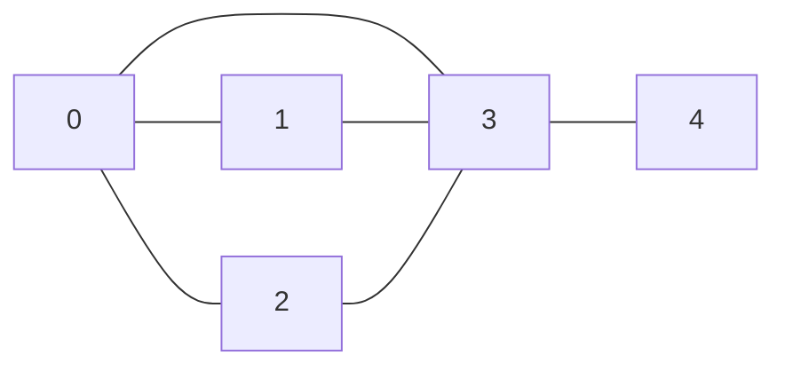

# Grafos
Algumas anotações sobre grafos.

Fontes:
- [Reducible](https://youtu.be/LFKZLXVO-Dg?si=EGvfo2NAVycpZ5gC)
- [Prof. João Paulo](https://youtu.be/8tbSJuusgBI?si=yIoHmCS5erwnrD2-)

## Introdução
### Definição
Um grafo G = (V, E) é um conjundo de nós (ou vértices, V) e arestas (E), no qual cada aresta representa a conexão entre dois nós.

### Terminologia
**Vizinhos**: neighbords(v) = nós conectados ao v;
**Grau**: degree(v) = número de arestas conectadas a v;
**Caminhos**: sequencia de nós conectados por arestas;
**Ciclo**: um caminho que começa e termina em um mesmo nó;
**Conectividade**: um grafo é conectado quando todos os seus nós estão conectados (existe um caminho entre um nó qualquer e qualquer outro nó).

### Tipos 
- Direcionados (->)
	- Ciclico / Acíclico
- Não direcionados (--)
- Ponderado (peso nas arestas)
- Árvores:
	1. Conetado e acíclico
	2. Remover uma aresta desconecta o grafo
	3. Adicionar um nó cria um ciclo (nao consegui enxergar?)

### Representações
Grafo de exemplo:

#### 1. Matriz de adjacência
- Colocamos 1 para indicar uma conexão, 0 para o contrário;
- Se tiver peso, basta colocar no lugar do 1;
- Vantagens:
	- Checar a presença de uma aresta O(1).
- Desvantagens:
	- Espaço na memória é grande;
	- Complexidade O(n^2) para examinar.
- Usar quando o grafo for **denso**.

- Exemplo:
	| - | 0 | 1 | 2 | 3 | 4 |
	|---|---|---|---|---|---|
	|**0**| 0 | 1 | 1 | 1 | 0 |
	|**1**| 1 | 0 | 0 | 1 | 0 |
	|**2**| 1 | 0 | 0 | 1 | 0 |
	|**3**| 1 | 1 | 1 | 0 | 1 |
	|**4**| 0 | 0 | 0 | 1 | 0 |

#### 2. Set de arestas
- Fazemos uma lista na qual cada indice contém uma aresta;
- Representamos uma aresta como um set de dois vértices conectados; 
- Não é muito utilizado.

- Exemplo:

  {(0,1), (0,2), (0,3), (1,3), (2,3), (2,4)}
	
#### 3. Lista de adjacências
- Fazemos uma lista de listas;
- Cada índice da lista representa um nó;
- Cada lista contém os vizinhos daquele nó;
- Vantagens:
	- Complexidade da busca é O(arestas), no pior dos casos (buscando por todos os elementos, checamos todas as arestas);
	- Tamanho total da estrutura é O (vértices + arestas).
- Desvantagens:
	- Checar a existência de uma aresta tem complexidade O(vértices), no pior dos casos.
- Usar quando o grafo for **esparso**.

- Exemplo:
	- [0] -> [1, 2, 3]
	- [1] -> [0, 3]
	- [2] -> [0, 3]
	- [3] -> [0, 1, 2, 4]
	- [4] -> [3]

## Algoritmos
- **Algoritmo de Welsh-Powell**: colorir um mapa político
- **Busca em Profundidade**: ...
- **Busca em Largura**: ...
